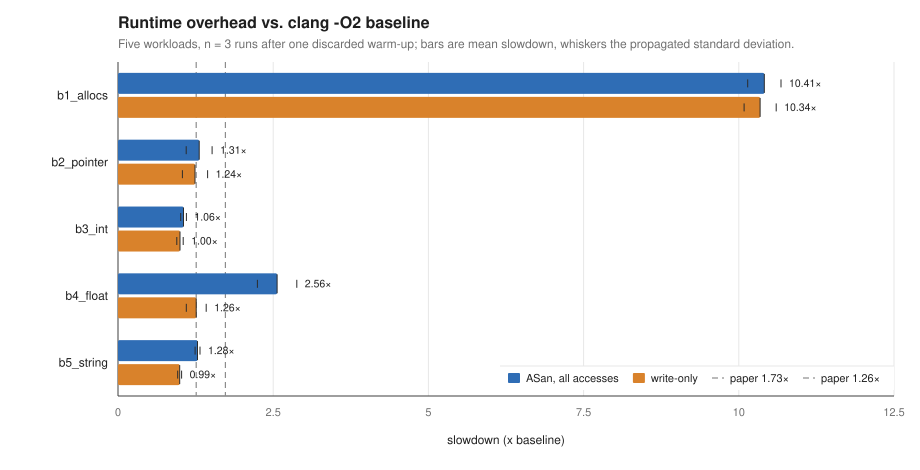
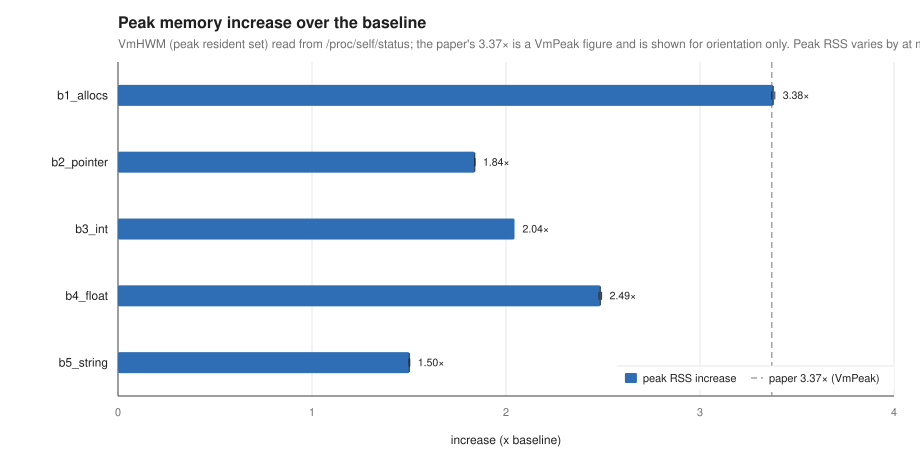

# Reproduction of *AddressSanitizer: A Fast Address Sanity Checker* (USENIX ATC '12)

CS340 Operating Systems — Research Paper Replication, AY 2026–27.

| | |
|---|---|
| **Paper** | Konstantin Serebryany, Derek Bruening, Alexander Potapenko, Dmitry Vyukov. *AddressSanitizer: A Fast Address Sanity Checker*. USENIX ATC 2012. |
| **Paper PDF** | https://www.usenix.org/system/files/conference/atc12/atc12-final39.pdf |
| **System under test** | AddressSanitizer as shipped with LLVM/Clang (we use the packaged `clang-14` from Ubuntu 22.04). No upstream file is patched. |
| **Our artefact** | The benchmark harness and measurement pipeline in this repository. |
| **Repository status** | Week 6 — submission-ready (tag `v1.0`): the full report is in [`docs/report.md`](docs/report.md), measurement data are four sessions at n = 18 per point, plus the variance analysis, the week-5 `-O` extension and the redzone check; see `docs/plan.md`. |

---

## 1. Purpose

The paper claims that shadow-memory instrumentation can be *fast*: it reports an average
**73 % slowdown** on SPEC CPU2006, **3.37× memory** overhead, and a write-only
instrumentation mode at **26 % slowdown**. This repository rebuilds the measurement around
those numbers on hardware and a toolchain that did not exist in 2012, and asks whether the
claims still hold.

Claims are enumerated in [`docs/claims.md`](docs/claims.md); every deviation from the paper's
setup is logged in [`docs/deviations.md`](docs/deviations.md). The written analysis — results,
discrepancy analysis, extension and conclusion — is [`docs/report.md`](docs/report.md).

## 2. Quick start (container)

```bash
docker build -t asan-repro .
docker run --rm -it -v "$PWD":/work asan-repro make all
```

PowerShell:

```powershell
docker build -t asan-repro .
docker run --rm -it -v "${PWD}:/work" asan-repro make all
```

`make all` = `make build` + `make run` + `make summarize` + `make figures`. It writes
`results/raw/<timestamp>-<host>.csv`, `results/summary.md` and the two figures in
`results/figures/`.

## 3. Starting code and what we pin

There is no upstream *paper* repository to fork: the artefact under test is the AddressSanitizer
pass and runtime that live inside LLVM. We therefore pin the toolchain instead of a commit:

- Ubuntu 22.04 (see `Dockerfile`)
- `clang-14` / `llvm-14` / `lld-14` from the Ubuntu archive
- the exact versions observed at run time are recorded in [`docs/environment.md`](docs/environment.md)
  by `make env`

**Files modified upstream: none.** Everything we add lives in this repository. This difference
from the usual "reproduce a paper's prototype" shape is recorded as deviation **D1** in
`docs/deviations.md`.

## 4. Build

```bash
make build            # 5 benchmarks x 3 build modes -> build/{base,asan,asanw}/
```

| Mode | Flags | Meaning |
|---|---|---|
| `base` | `-O2 -g` | the paper's comparison baseline (`clang -O2`) |
| `asan` | `-O2 -g -fsanitize=address -fno-omit-frame-pointer` | real AddressSanitizer |
| `asanw` | as `asan` + `-mllvm -asan-instrument-reads=0` | write-only instrumentation; the paper reports 26 % here |

Runtime settings for the `asan` modes are chosen to approximate the paper's configuration
(§4: *"32-byte redzones, disabled the stack unwinding during malloc and free and set the
quarantine size to zero"*):

```
ASAN_OPTIONS = malloc_context_size=0:quarantine_size_mb=0:detect_leaks=0:max_redzone=32
```

These are approximations, not exact equivalents — see deviations **D3**–**D5**.

## 5. Run

```bash
make run                        # 1 warm-up + 3 measured repetitions per (benchmark, mode)
RUNS=5 make run                 # more repetitions
CPU_PIN=2 make run              # pin to one core (recommended on noisy machines)
```

Output columns: `bench,mode,wall_s,vmpeak_kb,vmhwm_kb,vmsize_kb,checksum`.
All three memory fields are read from `/proc/self/status` — the same source the
paper used for Table 1. **Peak RSS (`vmhwm_kb`) is the primary memory metric**:
modern 64-bit ASan reserves one eighth of the address space for shadow memory,
and that PROT_NONE reservation inflates `VmPeak` into the terabyte range without
reflecting real memory use. `vmpeak_kb` is recorded so the effect can be shown
and explained, not so it can be compared to Table 1 directly. See the comment
block at the top of `bench/common.h`.

**Observed runtime.** The committed sessions hold 270 measured runs totalling 440 s of
process time; adding the discarded warm-up passes gives roughly 500 s, and compiling the
15 binaries adds the rest — `make all` takes about nine minutes here, with the measurement
dominating.

## 6. Results

`make summarize` produces [`results/summary.md`](results/summary.md) with mean ± standard
deviation over repetitions and the Paper-vs-Ours comparison; `make figures` renders the same
data as vector figures. Everything below comes from the committed session
`results/raw/` (four sessions, n = 18 per point: 3 + 5 + 5 + 5 runs), not from
placeholders. The spread between sessions is reported separately in
[`results/variance.md`](results/variance.md): it is smaller than the within-session noise
for every workload, so pooling is safe and there is no drift between evenings.



**Fig. 1** — mean slowdown per workload; whiskers are the propagated standard deviation.
The dashed lines mark the paper's 1.73× (all accesses) and 1.26× (write-only) averages.



**Fig. 2** — peak-RSS increase per workload. The dashed line is the paper's 3.37× VmPeak
figure, drawn for orientation only (see 6.2): it is a different metric. Peak RSS varies by
at most 0.26 % between runs, so the error bars are present but barely visible — memory is
almost deterministic here, unlike time.

### 6.1 Runtime overhead (paper: Figure 2, average 73 %)

Four sessions in `results/raw/`, n = 18 per point (3 + 5 + 5 + 5 runs), warm-up discarded
in each, baseline ≈ 0.5–1 s per run. 270 measured rows in total.

| Benchmark | Baseline (s) | ASan (s) | Slowdown | Write-only (s) | Slowdown | Closest CPU2006 analogue |
|---|---|---|---|---|---|---|
| `b1_allocs` — heap churn | 0.524 ± 0.010 | 5.458 ± 0.098 | 10.41× | 5.423 ± 0.092 | 10.34× | 400.perlbench (2.60×) * |
| `b2_pointer` — pointer chasing | 0.861 ± 0.093 | 1.125 ± 0.132 | 1.31× | 1.067 ± 0.132 | 1.24× | 429.mcf |
| `b3_int` — byte-wise hashing | 0.929 ± 0.030 | 0.981 ± 0.028 | 1.06× | 0.928 ± 0.037 | 1.00× | 401.bzip2 |
| `b4_float` — FP arrays | 0.815 ± 0.100 | 2.089 ± 0.033 | 2.56× | 1.027 ± 0.032 | 1.26× | 470.lbm * |
| `b5_string` — token scanning | 0.986 ± 0.025 | 1.263 ± 0.022 | 1.28× | 0.979 ± 0.018 | 0.99× | 483.xalancbmk (2.67×) |
| **Mean, all five** | | | **3.32× (+232 %)** | | **2.97× (+197 %)** | paper: 1.73× / 1.26× |
| **Mean, b2–b5 only** | | | **1.55× (+55 %)** | | **1.12× (+12 %)** | paper: 1.73× / 1.26× |

`*` Not a valid proxy — see the notes below. `b1_allocs` performs almost no work
besides `malloc`/`free`, so its ratio is an **upper bound on allocator overhead**,
not a replication of perlbench. `b4_float`'s cost sits on the load side
(2.56× with read checks versus 1.26× without); the de-vectorisation explanation
was tested and **rejected** — the loop is not vectorised in either build, and the
cost is already 2.54× at `-O1` (D16 → D20). Both means are reported so the reader
can see how much the second one depends on the `b1_allocs` exclusion.

### 6.2 Memory overhead (paper: Table 1, average 3.37× — but see the caveat)

| Benchmark | Baseline RSS (MB) | ASan RSS (MB) | Increase | ASan VmPeak (MB) |
|---|---|---|---|---|
| `b1_allocs` | 2.0 | 6.9 | 3.38× | 20 971 560 |
| `b2_pointer` | 10.9 | 20.1 | 1.84× | 20 971 560 |
| `b3_int` | 2.8 | 5.7 | 2.04× | 20 971 561 |
| `b4_float` | 1.9 | 4.8 | 2.49× | 20 971 560 |
| `b5_string` | 5.8 | 8.7 | 1.50× | 20 971 564 |
| **Mean** | | | **2.25×** (paper: 3.37×) | — |

The paper's 3.37× is a `VmPeak` measurement from 2012. Current ASan reserves
1/8 of the address space as shadow, so `VmPeak` is dominated by an unused
mapping and cannot be compared to Table 1. Peak RSS is the honest quantity;
the report must say this explicitly and treat "our 3.37× analogue" as a
different metric from the paper's figure. This is a deviation (**D13** in
`docs/deviations.md`), not a failure to reproduce.

### 6.3 Known comparability limits

The paper measures SPEC CPU2006 (licensed software, 2× Xeon E5620, 2010). We cannot obtain
SPEC, so the workloads are purpose-built stand-ins that isolate the access patterns the paper
singles out as expensive (small and 1–2-byte accesses, malloc churn). **Absolute slowdowns are
therefore not directly comparable to Figure 2**; what is comparable is the *ordering* of the
benchmarks and the approximate magnitude. This is the central subject of the report's
discrepancy analysis, not a defect to hide.

## 7. Layout

```
bench/        five C benchmarks + shared timing/measurement header
scripts/      build/run/summarize/figures/env helpers, commit-msg hook installer
docs/         claims, deviations, environment record, six-week plan
results/      raw per-run CSV (committed — the evidence trail), summary, figures
Dockerfile    pinned toolchain
Makefile      build / run / summarize / figures / env / clean
```

## 8. Credit and licence

- AddressSanitizer is part of LLVM, distributed under *Apache-2.0 WITH LLVM-exception*.
  This repository **does not redistribute** upstream code; the tool is consumed as a pinned
  Ubuntu package.
- The paper is © 2012 by the authors; USENIX permits reproduction for classroom use.
- Our code is MIT — see [`LICENSE`](LICENSE) and [`NOTICE.md`](NOTICE.md).

## 9. Contribution statement

The split below matches the commits: each member's weekly commit carries their student ID, and
`git log --format='%an %s'` is the audit trail. Per-member detail is in `docs/contributions/`.

| Member | Student ID | GitHub | Contribution |
|---|---|---|---|
| Li Haisheng | 1240009615 | @lhs58 | Repository scaffold, pinned toolchain and `Makefile`, all five benchmark programs and the bug-detection check, the measurement pipeline (`run.sh`, `summarize.py`, `variance.py`), all four measurement sessions, `claims.md`/`deviations.md`/`plan.md`, integration and release |
| Pan Haodong | 1240010383 | @Jeff-feng-dot | Week-5 extension (`-O` sweep: `extension_opt.sh`, `summarize_opt.py`, summary), PNG/PDF figure backend, Fig. 3, presentation outline, AI-usage log, D20 |
| Qi Sihao | 1240012742 | @QISIHAO | `scripts/figures.py` and the `make figures` target, Figs. 1–2 rendering and the README's figure documentation |
| Zhang Qixun | 1240006904 | @zhangqixun6904 | Week 6: documentation consistency pass (the `n = 13 → 18` correction, the refuted de-vectorisation note), `docs/report.md` and both required statements |

## 10. AI usage statement

Stated plainly, because the course requires it and because it is the honest account:

1. The initial scaffold — `Makefile` targets, script skeletons, first versions of the benchmark
   programs — was AI-generated and then reviewed, adapted and corrected by the group.
2. AI was used during the reading phase to explain ASan's shadow-memory design.
3. The week-5 extension (`scripts/extension_opt.sh`, `scripts/summarize_opt.py`, the figures' PNG/PDF
   backend, `presentation/outline.md`, deviation D20) was written by an AI assistant at Pan
   Haodong's direction, and the assistant also made the change of verdict on hypothesis (b). All of
   this is logged verbatim in `docs/ai-log.md`.
4. The first draft of `docs/report.md`, this section and §9 above, and the `docs/contributions/`
   updates were drafted by an AI assistant in Zhang Qixun's session on 2026-11-25. Every number in
   them is taken from the committed files in `results/` and re-checked against `results/raw/`; no
   value was invented.

No measurement run, no choice of experimental design, no `ASAN_OPTIONS` value and no reported number
was produced by an AI system: the AI wrote prose around data the group had already committed.
