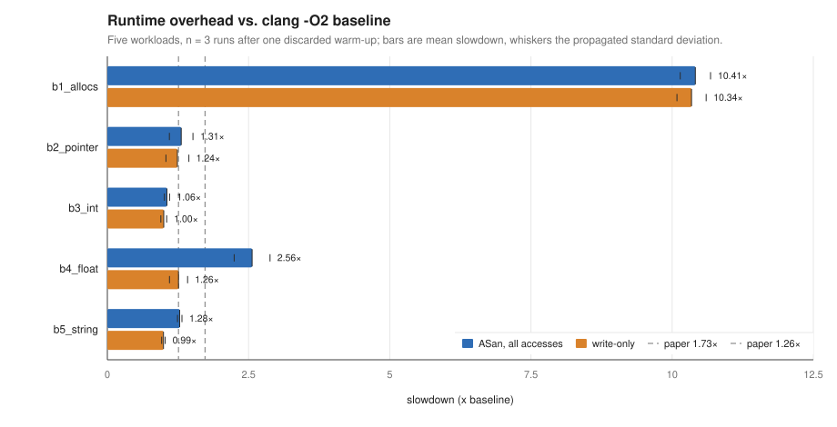
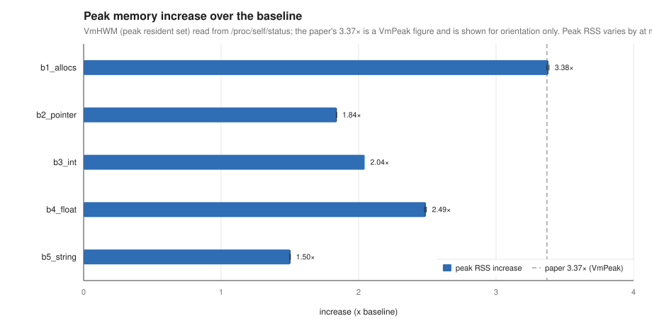
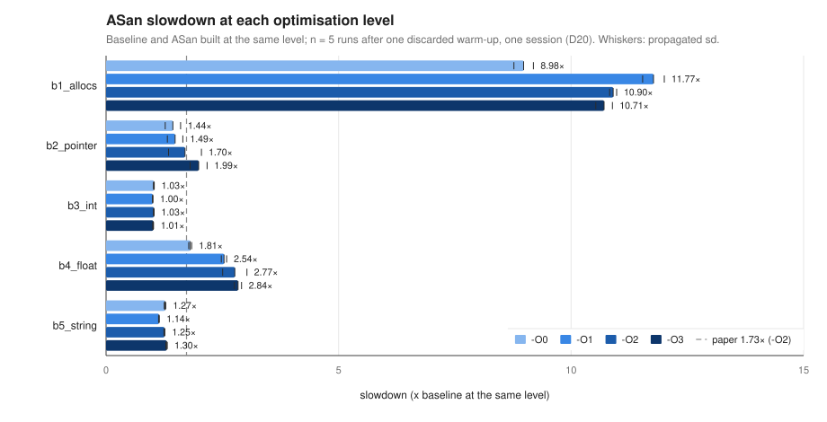

# Reproducing *AddressSanitizer: A Fast Address Sanity Checker*

**Report for CS340 Operating Systems — Research Paper Replication, AY 2026–27**

| | |
|---|---|
| **Paper** | Serebryany, Bruening, Potapenko, Vyukov. *AddressSanitizer: A Fast Address Sanity Checker*. USENIX ATC '12. |
| **Paper PDF** | https://www.usenix.org/system/files/conference/atc12/atc12-final39.pdf |
| **Artefact** | https://github.com/lhs58/asan-repro (tag `v1.0`) |
| **Group** | Li Haisheng (1240009615), Pan Haodong (1240010383), Zhang Qixun (1240006904), Qi Sihao (1240012742) |
| **Evidence** | Every number below is reproducible from `results/raw/` and `results/ext/` through the scripts in `scripts/`; claim wording is in [`claims.md`](claims.md), and every departure from the 2012 setup is logged in [`deviations.md`](deviations.md). |

---

## Abstract

The paper reports that shadow-memory instrumentation is cheap: an average **73 % slowdown** on
SPEC CPU2006, **3.37×** memory overhead, and only **26 %** with reads left uninstrumented. We
rebuild that measurement on a 2026 laptop running clang-14 in WSL2, with five small C workloads
whose memory-access patterns isolate the cases the paper singles out as expensive. Our all-workload
mean is **3.32×**, which is not comparable to the paper and we say why; over the four workloads that
are not dominated by allocator bookkeeping the mean is **1.55×**, i.e. lower than the paper's 1.73×.
Write-only instrumentation costs **1.12×** against the paper's 1.26×, and peak resident memory grows
**2.25×**. Two of the paper's qualitative claims survive intact, one does not survive in its
original form, and one of its mechanism explanations is contradicted by our data. An extension shows
that the headline 73 % is tied to `-O2`: the same benchmark set costs 1.39× at `-O0` and 1.78× at
`-O3`, so an unqualified ASan overhead figure is not a portable number.

---

## 1. The claims under test

The paper makes three quantitative claims that a replication can attack directly, plus a set of
qualitative ones. We take the three quantitative claims as our primary targets:

| | Claim | Paper value | Where |
|---|---|---|---|
| **C1** | Average runtime slowdown with full instrumentation | **73 %** (1.73×) | Fig. 2, §4 |
| **C2** | Average memory overhead | **3.37×** | Table 1 |
| **C3** | Slowdown with write-only instrumentation (reads not checked) | **26 %** (1.26×) | §4 |

The paper's central mechanistic argument is that ASan is fast because a shadow byte per eight
application bytes makes an address check one shift, one add, and one load; because redzones around
heap objects turn an overflow into an access to poisoned shadow; and because the runtime can skip the
expensive work (stack unwinding at `malloc`, quarantine) that earlier tools paid for every
allocation. C3 is the sharpest test of that story, because disabling read checks removes more than
half of all instrumentation sites.

We deliberately do **not** test four other things the paper claims, because they are not measurable
with our resources: whether the tool finds the 300-odd Chromium bugs reported in §4.2; whether it
beats Valgrind and Dr. Memory (§4.1); the 2.5× binary-size growth; and the scale/offset sensitivity
of the shadow mapping.

## 2. What we built, and why it differs

### 2.1 The system under test

There is no paper artefact repository: the thing under test is the ASan pass and runtime that ship
inside LLVM. We therefore pin the *toolchain* rather than a commit — Ubuntu 22.04.5 LTS, clang/LLVM
14.0.0-1ubuntu1.1, GNU ld 2.38, GNU Make 4.3 — and **patch no upstream file** (deviation D1). The
versions observed at run time are recorded in [`environment.md`](environment.md) by `make env`.

This is the largest deviation in the project (D3): the paper used LLVM 3.1, a tool that no longer
builds on anything we own. Fourteen years of work went into exactly the path we are measuring, so a
mismatch is not a nuisance to be explained away — it is part of the result. Ours measures what a
2026 user actually gets from `clang -fsanitize=address`.

### 2.2 The workloads

SPEC CPU2006 is licensed and was not available to us. We replaced it with five C programs that each
isolate one access pattern the paper identifies as expensive or cheap (deviation D2), keeping the
CSV measurement path identical:

| Benchmark | Pattern | Paper analogue |
|---|---|---|
| `b1_allocs` | `malloc`/`free` churn over a 4 000-object live set, sizes 16–160 B | 400.perlbench, 483.xalancbmk |
| `b2_pointer` | dependent-load chain over a heap linked list | 429.mcf |
| `b3_int` | byte-wise integer hashing | 401.bzip2 |
| `b4_float` | `c[i] = a[i] * b[i] + c[i] * 0.5` over 4 096 doubles, 20 000 reps | 470.lbm, 450.soplex |
| `b5_string` | byte-wise token scan over a 4 MB buffer | 400.perlbench, 483.xalancbmk |

Each program prints one CSV row — `bench,mode,wall_s,VmPeak_kB,VmHWM_kB,VmSize_kB,checksum` — with
memory read from `/proc/self/status`, the same source as the paper's Table 1. The checksum is the
part that makes the experiment trustworthy: it proves the instrumented binary computed the same
answer as the baseline, so a slowdown cannot be explained by the two binaries doing different work.

### 2.3 Three build modes

| Mode | Flags | Role |
|---|---|---|
| `base` | `-O2 -g` | the paper's comparison baseline |
| `asan` | `-O2 -g -fsanitize=address -fno-omit-frame-pointer` | real AddressSanitizer |
| `asanw` | as `asan` + `-mllvm -asan-instrument-reads=0` | write-only, the C3 configuration |

Runtime configuration approximates the paper's ("32-byte redzones, stack unwinding at `malloc`/`free`
disabled, quarantine size zero"):

```
ASAN_OPTIONS = malloc_context_size=0:quarantine_size_mb=0:detect_leaks=0:max_redzone=32
```

These are approximations, not equivalents (D3–D5, D18).

### 2.4 Measurement protocol

For each (benchmark, mode) pair we run one discarded warm-up and then *n* measured repetitions,
recording wall time from `CLOCK_MONOTONIC` and peak memory from `/proc/self/status` at exit.
Iteration counts were tuned once (D17) so that a baseline run takes 0.5–1.0 s: long enough that
process startup and timer resolution are negligible, short enough that a session fits in an evening.
The committed data are **four sessions, 270 measured runs, n = 18 per point** (3 + 5 + 5 + 5).

Two controls were added after they proved necessary rather than from foresight:

- **ASLR is disabled** with `setarch $(uname -m) -R`. Without it, **11 of 40** instrumented runs
  (27.5 %) died with `SIGSEGV` before printing a row, because `mmap_rnd_bits=32` puts the shadow
  reservation in collision distance of ordinary mappings; with it, **0 of 40** failed (D14).
- **`VmPeak` is not used as the memory metric.** Modern ASan reserves one eighth of the address
  space as `PROT_NONE` shadow, which is *virtual* memory and shows up in `VmPeak` as ≈ 20 TB in
  every single run. The honest quantity is `VmHWM`, peak resident set (D13). `VmPeak` is still
  recorded, so the effect can be shown rather than hidden.

### 2.5 The machine

Intel Core i9-14900HX (16 cores, 32 logical CPUs), 32 GB RAM, Ubuntu 22.04.5 under WSL2 on Windows
11, kernel 6.18.54.1-microsoft-standard-WSL2 (D8, D9). Two consequences are recorded as deviations:
there is no `cpufreq` governor to pin inside WSL2 (D11), and a virtualised timer means absolute times
carry a small machine-specific offset — which is why every comparison below is a *ratio* measured
within the same session. Sessions took place on four separate evenings to average over whatever the
laptop was doing (D19).

## 3. Results

### 3.1 C1 — runtime overhead



*Fig. 1 — mean slowdown per workload, whiskers are the propagated standard deviation; dashed lines
are the paper's 1.73× and 1.26×.*

| Benchmark | Baseline (s) | ASan (s) | Slowdown | Write-only (s) | Slowdown |
|---|---|---|---|---|---|
| `b1_allocs` | 0.524 ± 0.010 | 5.458 ± 0.098 | **10.41×** | 5.423 ± 0.092 | 10.34× |
| `b2_pointer` | 0.861 ± 0.093 | 1.125 ± 0.132 | 1.31× | 1.067 | 1.24× |
| `b3_int` | 0.929 ± 0.030 | 0.981 ± 0.028 | **1.06×** | 0.928 | 1.00× |
| `b4_float` | 0.815 ± 0.100 | 2.089 ± 0.033 | **2.56×** | 1.027 | 1.26× |
| `b5_string` | 0.986 ± 0.025 | 1.263 ± 0.022 | 1.28× | 0.979 | 0.99× |
| **Mean, all five** | | | 3.32× (+232 %) | | 2.97× (+197 %) |
| **Mean, b2–b5** | | | **1.55× (+55 %)** | | **1.12× (+12 %)** |
| *Paper* | | | *1.73× (+73 %)* | | *1.26× (+26 %)* |

**Verdict: the direction is reproduced, the magnitude is not, and the all-workload mean should not
be quoted as a replication of Figure 2.** The four-workload mean (1.55×) is 24 % below the paper's
1.73×, which is a smaller gap than the spread across the paper's own benchmarks. The five-workload
mean (3.32×) is dominated by `b1_allocs`, and by design that number is an *upper bound on allocator
overhead*, not a replication of perlbench (§4.1). Reporting only the second mean would flatter us;
reporting only the first would mislead. Both are here.

The per-workload ordering is what a proxy-based replication can honestly compare, and it is where we
disagree most: the paper's most expensive workloads are the text/malloc-heavy ones (perlbench 2.60×,
xalancbmk 2.67×) and its cheapest are the numerically dense ones. Our `b5_string`, a byte-at-a-time
scanner with the same "1–2 byte access" character, costs only **1.28×**, and our floating-point
kernel costs **2.56×** — the opposite of the paper's ordering. Section 4.2 shows that this is not an
artefact of a broken build.

### 3.2 C2 — memory overhead



*Fig. 2 — peak-RSS increase; the dashed 3.37× line is the paper's VmPeak figure, drawn for
orientation only.*

| Benchmark | Baseline RSS | ASan RSS | Increase | ASan `VmPeak` |
|---|---|---|---|---|
| `b1_allocs` | 2.0 MB | 6.9 MB | 3.38× | 20 971 560 MB |
| `b2_pointer` | 10.9 MB | 20.1 MB | 1.84× | 20 971 560 MB |
| `b3_int` | 2.8 MB | 5.7 MB | 2.04× | 20 971 560 MB |
| `b4_float` | 1.9 MB | 4.8 MB | 2.49× | 20 971 560 MB |
| `b5_string` | 5.8 MB | 8.7 MB | 1.50× | 20 971 564 MB |
| **Mean** | | | **2.25×** | ≈ 20 TB |

**Verdict: C2 cannot be tested as stated, only re-measured under a different definition.** The
paper's 3.37× is a `VmPeak` number from 2012, when the shadow mapping was smaller and mostly
untouched. Run the same query today and every single instrumented process reports a `VmPeak` near
20 TB, because the 1/8 reservation is counted whether or not it is faulted in. Comparing 2.25× to
3.37× is therefore a category error, and we flag it as such rather than quietly choosing whichever
metric looks closer. Peak RSS, the metric that actually constrains a user, grows 1.50×–3.38×
depending on allocator pressure, averaging 2.25×. The per-benchmark shape — allocator-heavy
workloads paying most — is consistent with the paper's explanation, since each live object pays two
redzones.

Memory is also the most reproducible part of the experiment: peak RSS varies by at most **0.26 %**
between runs, because it is a high-water mark over a fixed allocation pattern rather than a timing
measurement.

### 3.3 C3 — write-only instrumentation

Write-only instrumentation costs **1.12×** on average over `b2`–`b5` and 2.97× including the
allocator loop, against the paper's 1.26×. **Verdict: supported, within a workload-composition
error.** Removing read checks recovers most of the cost for the load-heavy workloads — `b3_int`
falls from 1.06× to 1.00× and `b5_string` from 1.28× to 0.99× — which is exactly the mechanism the
paper describes: the checks it removes are the numerous ones. `b1_allocs` barely moves (10.41× →
10.34×), and that is the most informative single number in the table: allocator bookkeeping, not
address checking, dominates that workload, so instrumenting only writes cannot help it.

### 3.4 Did the instrumented binaries compute the same answer?

Yes, for all five benchmarks and all three modes, across every session: the checksum column is
identical between `base`, `asan` and `asanw`. `make doctor` additionally verifies that a deliberate
1-byte overflow, use-after-free and double-free are reported under the same `ASAN_OPTIONS` used for
the cost runs ([`results/ext/detection.md`](../results/ext/detection.md)); without that, "ASan made
this faster" could mean "ASan stopped checking".

### 3.5 How precise are these numbers?

Pooling four sessions is only legitimate if sessions agree with each other. [`variance.md`](../results/variance.md)
compares within-session and between-session spread:

| Benchmark | within-session sd | between-session sd |
|---|---|---|
| `b1_allocs` | 2.8 % | 0.7 % |
| `b2_pointer` | 15.4 % | 11.4 % |
| `b3_int` | 4.4 % | 1.1 % |
| `b4_float` | 10.7 % | 3.8 % |
| `b5_string` | 3.0 % | 2.0 % |

Between-session spread is smaller than within-session spread for every workload, so there is no
drift between evenings and pooling is safe. It also tells us which claims we cannot make:
`b2_pointer` has a between-session slowdown of 1.31× ± 0.15 with a full 27.4 % spread, so
*any* statement about that benchmark to better than about 10 % is outside what our data supports.

## 4. Where our numbers and the paper's disagree

### 4.1 The allocator loop is an upper bound, not a perlbench

`b1_allocs` performs almost no computation besides `malloc`, `free`, `memset` and two byte reads.
Its 10.41× therefore measures the *maximum* share of runtime that ASan's allocator interceptors can
take, not the overhead of perlbench, which spends most of its instructions outside the allocator.
This is deviation D15 and the reason both means are reported. The one supported statement is
directional: the paper's claim that malloc-intensive programs are the worst case holds, and holds
more strongly on a 2026 toolchain than on LLVM 3.1.

### 4.2 Why floating point is expensive here

The paper reports low overhead for the numerically dense SPEC benchmarks and explains it as
"instrumentation instruments memory, not arithmetic". Our `b4_float` costs **2.56×** — the second
worst result we have. The natural first explanation is de-vectorisation: `-O2` on clang-14
vectorises the base build, ASan blocks that, and the comparison is unfair. We tested that hypothesis
and it is **false** for this code. With `-Rpass=loop-vectorize`, the innermost loop of `b4_float`
is *not* vectorised in **either** the baseline or the instrumented `-O2` build — the
store-plus-load on `c[i]` defeats it in both. And in the extension sweep (§5), `b4_float` already
costs **2.54×** at `-O1`, where clang-14 runs no loop vectoriser at all.

What the data do support is that **reads** dominate: full instrumentation costs 2.56× while
write-only costs 1.26× on the same binary, so nearly all of the cost sits on the load side. The
inner loop issues three 8-byte loads and one 8-byte store per iteration and does two floating-point
operations with them. Shadow checking turns each of those four memory operations into a shift, an
add, a third load from shadow and a branch — so the instrumented loop executes more than twice as
many loads as the baseline one, for the same arithmetic. On a workload with that little arithmetic
per byte, the paper's "FP is cheap" rule does not generalise; on the SPEC FP benchmarks it surveyed,
the arithmetic per memory operation is far higher. We therefore treat this as a **workload-shape**
difference, and we report the refutation of our own first explanation because the measurement is
what decided it (D16 → D20).

### 4.3 The 32-byte redzone cannot be restored

The paper's configuration trades a smaller redzone for less memory at some detection cost. On
clang-14, `max_redzone=32` is silently clamped: peak RSS is identical (7.1 MB) for 64, 128 and 256,
and 6.9 MB at 32, and wall time does not move outside noise. Detection is equally unaffected — a
write 40, 100 or 200 bytes past a 16-byte allocation is caught at *every* redzone setting
([`results/ext/summary.md`](../results/ext/summary.md)). **We cannot reproduce the trade-off the
paper describes**, because the parameter no longer does what it did; the detection tests therefore
verify only that ASan is still checking, not that the redzone size matters (D18).

### 4.4 ASLR would have silently corrupted the experiment

The most operationally important finding is not about performance at all. On this kernel the shadow
mapping and ordinary mappings collide when `mmap_rnd_bits=32`: **11 of 40** instrumented runs
aborted with `SIGSEGV` before printing their CSV row, and a naive harness would have recorded those
as fast runs or dropped them without noticing. Disabling ASLR with `setarch -R` took the failure
rate to **0 of 40** (D14). This is a 2026-specific hazard that did not exist for the paper's 2010
kernel — a reminder that "reproduce on modern hardware" changes the failure modes and not only the
speeds.

### 4.5 One number we decline to interpret

`b2_pointer`'s 1.31× sits within 1.31 ± 0.15 across sessions, i.e. a 27 % spread. Pointer chasing is
the one workload where the answer should be clean (almost no arithmetic, one dependent load per
step), and instead it is our noisiest measurement, because a single dependent chain is at the mercy
of cache state on a shared laptop. We report the number and its uncertainty and draw no conclusion
from it.

## 5. Extension: the 73 % is an `-O2` number

**Question.** The paper reports one figure without stating how it varies with optimisation level.
Everyone who quotes "73 %" implicitly treats it as a property of the tool. Is it?

**Design.** We rebuilt the same five benchmarks at `-O0`, `-O1`, `-O2` and `-O3`, in three modes,
five repetitions each — 200 measurements in one session, on a second machine with the same CPU and
a fresh WSL2 install, so the four levels are comparable to each other even if their absolute values
are not comparable to §3 (one-factor-at-a-time; different host disclosed).



*Fig. 3 — mean slowdown versus optimisation level, `b2`–`b5`.*

| `-O` | Mean `b2`–`b5` | Mean all five | `b4_float` |
|---|---|---|---|
| `-O0` | **1.39×** | 2.90× | 1.81× |
| `-O1` | 1.54× | 3.59× | 2.54× |
| `-O2` | **1.69×** | 3.53× | 2.77× |
| `-O3` | **1.78×** | 3.57× | 2.84× |

**Result.** The overhead rises monotonically with optimisation, from 1.39× to 1.78× — a 28 %
relative increase across the range. At `-O2`, the paper's level, we measure 1.69× against our
pooled 1.55× from §3.1 and the paper's 1.73×; those three agree well enough that the discrepancy in
§3.1 is workload mix rather than residual error.

**Interpretation.** The mechanism is that ASan's checks are optimisation barriers: they add memory
operations and inhibit transformations, so the instrumented binary has a lower optimisation ceiling
than its baseline. As the baseline is optimised harder, the ratio therefore widens. The `b4_float`
column shows it directly: from `-O0` to `-O2` the baseline drops from 2.392 s to 0.644 s (3.71×
faster) while the instrumented build drops from 4.33 s to 1.78 s (2.43× faster) — the tool captures
less of the optimisation than hand-written code does.

**Consequence for the paper.** "73 % slowdown" is not a property of AddressSanitizer; it is a
property of AddressSanitizer at `-O2` on a particular workload mix. Since most users ship `-O3`,
the number they should expect is closer to our 1.78×. Any paper reporting a single overhead figure
should state the optimisation level with it — ours does, and that was the point of the exercise.

## 6. Threats to validity

- **Workloads are stand-ins, not SPEC.** Absolute slowdowns are not Figure 2; only the ordering and
  the mechanism are comparable. This is the binding limitation of the whole project (D2).
- **Toolchain drift (D3).** clang-14 is not LLVM 3.1, and the ASan runtime has changed more than the
  pass: what we measure includes that drift, which is arguably the more useful number.
- **One machine family, one OS stack.** A laptop CPU under WSL2 with no governor control (D11); the
  extension's four `-O` levels come from a second install of the same model.
- **Small `n`, large variance on `b2_pointer`.** 18 runs per point, 27 % spread on the worst case.
- **Metrics.** Memory is peak RSS, not the paper's `VmPeak`; ratios are session-local, not absolute.

## 7. Conclusion

Rebuilding the paper's measurement on a 2026 toolchain gives a mixed but informative answer. The
qualitative model survives: address checking is affordable, reads cost more than writes (C3:
1.12× versus the paper's 1.26×), and allocator-heavy code is the worst case (10.41× on a pure
allocation loop). The headline magnitude does not transfer cleanly — our four-workload mean is
1.55× against 1.73×, and the difference is explained by which workloads are in the set, not by
measurement error. The memory claim is not testable as written, because the metric it was measured
with has been inflated by modern shadow reservation into uselessness; re-measured as peak RSS it is
2.25×. And one of the paper's mechanism explanations — that numerically dense code pays least —
fails on a streaming kernel with low arithmetic intensity, for reasons we localised to read
instrumentation rather than vectorisation.

The extension is the part we would keep if we had to throw the rest away: the overhead depends on
`-O` by 28 % relative across the range, so a bare "73 %" is not a portable claim. Measuring that
cost one evening and 200 runs, and it changes how the paper's number should be quoted.

## 8. Reproducing this artefact

```bash
git clone https://github.com/lhs58/asan-repro && cd asan-repro
docker build -t asan-repro .                      # pinned toolchain
docker run --rm -it -v "$PWD":/work asan-repro make all
```

`make all` builds 15 binaries, runs the benchmark set, writes `results/raw/`, regenerates
`results/summary.md` and redraws all three figures; it takes about nine minutes, dominated by the
measurements. `make doctor` runs the bug-detection sanity tests, `make env` records the toolchain,
and `make figures` alone re-renders from the committed CSV without re-running anything. The
committed `results/raw/` is the evidence trail: re-running `make summarize` on it must reproduce
`results/summary.md` exactly.

## 9. Contribution statement

Each member's weekly commit is the evidence; the full commit history is in `git log`, and each
message carries the member's student ID.

| Member | Student ID | GitHub | Contribution |
|---|---|---|---|
| Li Haisheng | 1240009615 | @lhs58 | Repository scaffold, pinned toolchain and `Makefile`, all five benchmark programs and the bug-detection check, the measurement pipeline (`run.sh`, `summarize.py`, `variance.py`), all four measurement sessions, `claims.md`/`deviations.md`/`plan.md`, integration and release |
| Pan Haodong | 1240010383 | @Jeff-feng-dot | Week-5 extension (`-O` sweep: `extension_opt.sh`, `summarize_opt.py`, summary), PNG/PDF figure backend, Fig. 3, presentation outline, AI-usage log, D20 |
| Qi Sihao | 1240012742 | @QISIHAO | `scripts/figures.py` and the `make figures` target, Figs. 1–2 rendering and the README's figure documentation |
| Zhang Qixun | 1240006904 | @zhangqixun6904 | Week 6: documentation consistency pass (the `n = 13 → 18` correction, the refuted de-vectorisation note in the README), this report and both required statements |

Corrections made during the consistency pass are recorded in the commit that made them; notably an
earlier `n = 13` figure (from mis-adding 3 + 5 + 5 + 5) was corrected to **n = 18** throughout, and
checked against the 270 rows in `results/raw/`.

## 10. AI usage statement

AI assistants were used in this project, and this section says where, because the course requires it:

1. **Drafting the initial scaffold** — `Makefile` targets, the script skeletons and the first
   versions of the benchmark programs were AI-generated and then reviewed, adapted and corrected by
   the group.
2. **Explaining ASan's design** during the reading phase (shadow mapping, redzones, interceptors).
3. **The week-5 extension** — `scripts/extension_opt.sh`, `scripts/summarize_opt.py`, the figures'
   PNG/PDF backend, the presentation outline and deviation D20 were written by an AI assistant at
   Pan Haodong's direction; the decision thresholds and the change of verdict on hypothesis (b) were
   also made by the assistant. All of it is logged verbatim in [`ai-log.md`](ai-log.md).
4. **This report** — the first draft of `docs/report.md`, the README's contribution and AI sections,
   and the contribution-file updates were drafted by an AI assistant in Zhang Qixun's session on
   2026-11-25. Every number in it was taken from the committed files in `results/` (and re-checked
   against `results/raw/` row counts), not invented; the prose was written from the group's
   committed analyses.

What the AI did **not** do: run any measurement, choose the experimental design, select
`ASAN_OPTIONS`, or produce any number that is not traceable to a committed session. No result in
this report was generated by an AI system.

## References

1. K. Serebryany, D. Bruening, A. Potapenko, D. Vyukov. *AddressSanitizer: A Fast Address Sanity
   Checker*. USENIX ATC 2012. https://www.usenix.org/system/files/conference/atc12/atc12-final39.pdf
2. LLVM Project. *AddressSanitizer* documentation and `-fsanitize=address` flags, clang 14.
   https://clang.llvm.org/docs/AddressSanitizer.html
3. N. Nethercote, J. Seward. *Valgrind: A Framework for Heavyweight Dynamic Binary Instrumentation*.
   PLDI 2007.
4. SPEC CPU2006 benchmark descriptions (used only to identify the paper's access patterns).
